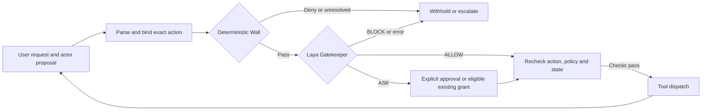

# Permissions That Learn

Research project with Graduates Rising in Data Science, a club at the University of Southern California (USC).

[Manuscript](paper/manuscript.pdf) · [Documentation](docs/README.md) · [Results](docs/results/research-release/README.md) · [Reproduction](docs/guides/reproduce.md)

This project studies whether an agent's proposed tool action is authorized by the authentic user request,
fixed policy, and verified context. A deterministic Wall enforces hard boundaries; Laya evaluates
contextual authorization; explicit grants and isolated user learning can reduce optional confirmations.
The controller rechecks the exact action before dispatch. Learned behavior cannot override the Wall,
a mandatory confirmation, or a Gatekeeper BLOCK.

## Authorization pipeline

The shared controller supports native AgentDojo Workspace, Slack and Banking, OpenAI-compatible
acting models, and unprotected, Wall-only and Wall-plus-Gatekeeper modes. Actor-specific settings
stay in model profiles. Application developers can supply their own actor, tool runtime and trusted
fact resolver through the same [integration contracts](docs/guides/integration.md).

This repository is released under the [Apache License 2.0](LICENSE). Model checkpoints, AgentDojo, datasets, figures and other external assets remain subject to their own licenses and terms; see the relevant model cards and data source before redistribution.

## Research questions and evidence

The primary evaluation compares identical recorded actions and decision-time evidence across
protection configurations. ALLOW, ASK and BLOCK agreement, false approvals, coverage and computation
cost are distinct from native AgentDojo task utility and attack success. Independent reviewed
labels remain necessary for definitive authorization-accuracy claims.

- **Permission enforcement:** 36 constructed sequences across three suites, with zero forbidden
  dispatches in the recorded no-memory, explicit-grant and contextual-learning checks.
- **Real inference:** small base-Laya and Cybersec CPU checks completed. Successful inference
  does not establish correct authorization; the published evidence includes disagreements.
- **Laya comparisons:** all saved screening configurations and selected full-cohort results are
  provided with accuracy, false approvals, latency, CPU time and memory. Labels are provisional.
- **Learning:** persistent exact grants and a per-user contextual learner are integrated into the
  controller. Offline LinUCB-style, Thompson and epsilon-greedy comparisons are research controls.
  Weight fine-tuning, calibration and checkpoint promotion remain unfinished.

Read the [evidence index](docs/results/README.md) for assumptions, historical experiments and limitations.
The supplied [manuscript](paper/manuscript.pdf) is a research manuscript; no acceptance or publication
status is asserted. Results must be reconciled with the manuscript before submission.

## Repository

| Directory | Role |
|---|---|
| `src/grids/` | Reusable authorization pipeline, model adapters, native benchmarks and evaluation CLI |
| `configs/` | Model pins, policies and declarative experiment configurations |
| `environments/` | Dependency profiles for separate runner and model environments |
| `experiments/notebooks/` | Research walkthroughs using the shared CLI and saved evidence |
| `docs/` | Architecture, reproduction, integration, evidence and project status |
| `paper/` | Supplied research manuscript |
| `tests/` | Retained authorization, data-integrity and pipeline regression checks |
| `scripts/` | Scheduler entry points |

Generated datasets, models, environments and raw runs stay outside the tracked release.
Selected aggregate evidence is committed under `docs/results/`.

## Demonstration software

A separate demonstration-software branch is planned; its name and release will be announced here
once reviewed. It will use this repository's authorization pipeline as its core. The research
checkout already provides a [local simulated demonstration](docs/guides/reproduce.md), with no
real email, banking or file-changing service integration required.

Development follows [PROJECT_GUIDELINES](docs/PROJECT_GUIDELINES.md); current completion status
and remaining research work are recorded in [project_tracking](docs/project_tracking.md).
