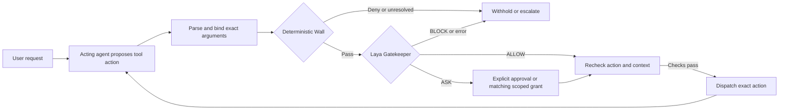

# Permissions That Learn

### Policy-bounded authorization for tool-using language model agents

*Research project with Graduates Rising in Data Science, a student club at the University of Southern California (USC).*

[**Research page**](https://AtharvaThorat.github.io/permission-that-learn/) · [**Dataset**](https://huggingface.co/datasets/siddharth-magesh/grids-laya-permission-v1) · [**Paper**](paper/manuscript.pdf) · [**Results**](docs/results/research-release/README.md) · [**Demo**](#demonstration)

## Contents

- [Research idea](#research-idea)
- [How the pipeline works](#how-the-pipeline-works)
- [Implementation](#implementation)
- [Research results](#research-results)
- [Demonstration](#demonstration)
- [License and acknowledgment](#license-and-acknowledgment)
- [Authors](#authors)

## Research idea

Tool-using agents can propose actions that exceed the user's request or trusted permissions. This project explores an authorization layer that evaluates each proposed action before execution, combining deterministic policy enforcement with contextual model decisions and carefully scoped permission learning.

The primary question is whether the system makes the right **ALLOW**, **ASK**, or **BLOCK** decision for a proposed action and its evidence. We measure authorization decisions and inference cost alongside AgentDojo's native task utility and attack success. Task completion alone does not establish that an action was authorized.

## How the pipeline works

The Wall applies fixed capability, resource, recipient, policy, and state checks. Laya evaluates whether the action follows the authentic request using trusted evidence. An ASK withholds the action for approval; a reusable grant must match its exact scope and remain valid. Before dispatch, the controller verifies the same action, state, policy, schema, and grant. Learning cannot override a Wall denial, mandatory confirmation, or Gatekeeper BLOCK.

## Implementation

One Python package and CLI provide the shared controller for native AgentDojo **Workspace**, **Slack**, and **Banking** tasks. The runner supports `unprotected`, `wall_only`, and `wall_gatekeeper` modes, with actor profiles for model-specific serving and tool parsing.

The implementation is organized around a few components:

- `src/grids/actors/` connects acting models through reusable clients and profiles.
- `src/grids/benchmarks/agentdojo/` adapts native tasks, tools, context, and scoring.
- `src/grids/wall/` evaluates deterministic permissions from trusted facts.
- `src/grids/gatekeeper/` prepares evidence for Laya and validates its decisions.
- `src/grids/core/` binds actions, requests approval, and gates tool dispatch.
- `src/grids/evaluation/` captures actions, replays identical inputs, and computes research metrics.
- `src/grids/runs/` schedules episodes and stores traces, attempts, and reports.

The same controller can be used by another application through its actor, tool-runtime, and trusted-facts interfaces. See the [integration guide](docs/guides/integration.md) and [documentation index](docs/README.md).

## Research results

The [results page](docs/results/research-release/README.md) provides the saved HTML report, CSV comparisons, JSON summaries, and source provenance. The evidence includes controlled permission checks, small real CPU inference checks, and Laya comparisons against provisional labels. These are distinct forms of evidence; provisional-label agreement is not independent human-ground-truth accuracy. Fine-tuning, calibration, and checkpoint promotion remain future work.

## Demonstration

The plugin is under separate development in `plugin/`. The research repository includes a [local simulated demonstration](docs/guides/reproduce.md); it does not connect to real email, banking, or file-changing services.

## License and acknowledgment

This repository is released under the [Apache License 2.0](LICENSE). Model checkpoints, AgentDojo, datasets, and external assets retain their own licenses and terms.

Developed with Graduates Rising in Data Science at USC.

## Authors

  
  
  

[Siddharth Magesh](https://github.com/Siddharth-magesh) · [Atharva Thorat](https://github.com/AtharvaThorat) · [Kaustubh Adhe](https://github.com/kaustubhadhe1206)

<a href="#permissions-that-learn">Back to top</a>

