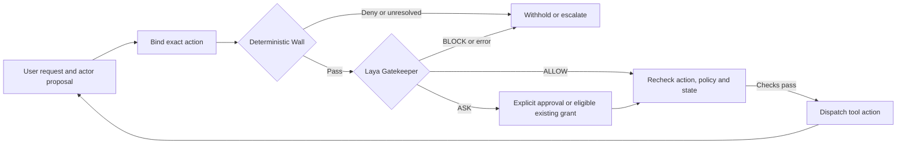

# Permissions That Learn

*Research project with Graduates Rising in Data Science, a student club at the University of Southern California (USC).*

**Manuscript:** [Policy-Bounded Authorization and Approval Learning for Tool-Using LLM Agents](paper/manuscript.pdf)

[Documentation](docs/README.md) · [Research results](docs/results/research-release/README.md) · [Reproduction guide](docs/guides/reproduce.md) · [Application integration](docs/guides/integration.md)

## Contents

- [About](#about)
- [Research approach](#research-approach)
- [Current evidence](#current-evidence)
- [Repository structure](#repository-structure)
- [Demonstration software](#demonstration-software)
- [License and acknowledgments](#license-and-acknowledgments)

## About

Tool-using agents can propose actions that exceed the user's request or trusted permissions. This project studies a policy-bounded authorization pipeline that evaluates each proposed action before execution. A deterministic Wall enforces fixed boundaries; Laya assesses contextual authorization; explicit, scoped grants and per-user learning can support eligible approvals. The controller checks the same action again before dispatch.

## Research approach

The primary research question is whether the system makes the right **ALLOW**, **ASK**, and **BLOCK** decisions for the same recorded actions and evidence. We measure decision agreement, false approvals, coverage, and inference cost. AgentDojo's native task utility and attack success provide additional outcome measures; they do not replace authorization labels.

The shared controller supports native AgentDojo Workspace, Slack, and Banking suites; unprotected, Wall-only, and Wall-plus-Gatekeeper modes; and configurable acting-model profiles. Applications can provide their own actor, tool runtime, and trusted fact resolver through the [integration contracts](docs/guides/integration.md).

## Current evidence

- **Permission checks:** 36 constructed sequences per strategy across the three suites. Recorded checks had zero forbidden dispatches.
- **Real inference:** small CPU checks ran with base Laya and Laya-Cybersec. Successful inference alone does not establish decision quality.
- **Laya comparisons:** saved screening and selected full-cohort results report agreement with provisional labels, false approvals, latency, CPU time, and memory. These labels are not independent human ground truth.
- **Learning:** exact expiring grants and a per-user contextual learner are integrated. Offline learning comparisons are research controls. Laya fine-tuning, calibration, and checkpoint promotion remain future work.

See the [results index](docs/results/README.md) for provenance, interpretations, and limitations. The manuscript is supplied for research review; this repository makes no claim of acceptance or publication. Confirm that manuscript claims match the released evidence before submission.

## Repository structure

| Directory | Contents |
|---|---|
| `src/grids/` | Authorization pipeline, model adapters, AgentDojo integration, and evaluation |
| `configs/` | Model profiles, policies, and experiment configurations |
| `environments/` | Runner and model dependency profiles |
| `experiments/notebooks/` | Research walkthroughs that use the shared pipeline |
| `docs/` | Architecture, guides, results, and project status |
| `paper/` | Research manuscript |
| `tests/` | Authorization, data-integrity, and pipeline checks |
| `scripts/` | Scheduler entry points |

Generated datasets, model assets, environments, and raw runs are kept outside the tracked release. Selected aggregate results and their provenance are in `docs/results/`.

## Demonstration software

A separate demonstration-software branch is planned and will be linked here after it is reviewed. It will use this authorization pipeline as its core. The current research checkout includes a [local simulated demonstration](docs/guides/reproduce.md); it does not connect to real email, banking, or file-changing services.

## License and acknowledgments

This repository is released under the [Apache License 2.0](LICENSE). Model checkpoints, AgentDojo, datasets, and other external assets retain their own licenses and terms; consult their source pages before redistribution.

Developed as a research project with Graduates Rising in Data Science at USC. See [project tracking](docs/project_tracking.md) for completed work and remaining research tasks.
