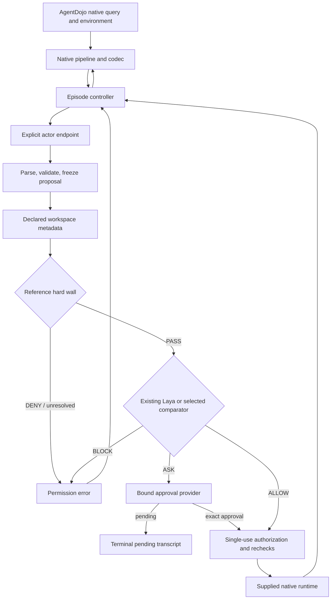

# Guarded AgentDojo black box

Status: **IMPLEMENTED / STATICALLY REVIEWED; runtime NOT RUN**. This is an
inference/evaluation integration, with no training, online learning or real services.

`blackbox.build_agentdojo_pipeline(config, dependencies=None)` constructs a native
`BasePipelineElement` without opening HTTP connections, starting workers, loading
tokenizers, or downloading assets. Config can be a `Config`, dictionary, or JSON
path. `Dependencies` provides explicit test/teammate seams for actor, wall, gate,
facts, clock, approval provider, audit, executor, run identity and episode metadata.
There is no automatic scripted fallback.

Each `query` starts a fresh opaque episode and attempt identity. The controller
initializes missing system/task messages once, translates native history, asks the
actor for structured proposals, and mediates calls sequentially. It never exposes
the runtime or environment object to the actor. `extra_args` is returned unchanged;
none of it enters the actor or gate. Suite/task/injection IDs are orchestration
metadata only. The runner provides them explicitly, without relying on AgentDojo
to include IDs in `extra_args`.

Argument validation uses the actual native Pydantic schema before dispatch.
Defaults/coercions become the immutable JSON snapshot both permission checks and
dispatch use. Original values are retained separately in memory. Unsupported Python
objects, including native nested `FunctionCall` instances, are rejected recursively.
Ordinary JSON dictionaries with `function`/`args` keys remain data.

The reference wall enforces effect, recipient, resource-scope and label rules.
It is **not the wall teammate's implementation**. Workspace identities and state
fingerprints come from declared fields; labels come only from a versioned project
sidecar. Actor-provided labels/contact claims cannot become authority. Recipient
membership is fixed policy data; contact-list edits cannot silently expand it.
Missing required identities or labels prevent dispatch. Collection reads are
conservative: the wall checks the full relevant collection's scope/labels, without
using hidden task criteria to predict search matches.

The existing Laya worker, `single-v1` prompt and deterministic policy are reused.
The only existing-package change is an optional request-validator seam in
`Gatekeeper`; default callers retain the original prototype validation. The native
adapter supplies actual runtime schemas, preserves native names/arguments, and
passes only task/action/declared metadata/effects. It does not rename workspace
tools into incomplete prototype equivalents. Laya's behavior on these new tool
names has not been evaluated. Its existing narrow UTC rule applies only to the
prototype calendar names, not native calendar strings; no new semantic date rule
has been invented.

All dispatch is in `blackbox/execution.py`. Controller-owned opaque authorization
references bind episode, attempt, action digest, schema, policy content hash,
relevant state hash and expiry. The executor repeats validation/fact resolution
and wall checks immediately before consuming the authorization and dispatching the
exact snapshot. Stale bindings fail closed with a recoverable error; a subsequent
actor proposal must be evaluated afresh. Completed attempts can be redelivered
without dispatch. Distinct equal-argument attempts remain distinct.

ASK records retain the exact action and binding in episode memory and emit a
redacted audit event. The default provider leaves the episode pending and closes
all calls in the emitted batch. Scripted approvals are trusted test inputs, never
LLM text or benchmark labels. Approval cannot override a wall denial. Durable
pending storage, human UI, cross-process replay protection and resume are deferred.

After BLOCK, remaining batch members are cancelled; the actor may revise its
proposal on the next turn. After ASK or execution uncertainty, the episode stops.
Every emitted native call receives a correlated result. Actor/protocol/audit
failures produce a final status so the native harness does not retry a silent
episode. Native successful formatting and all advertised tool schemas are shared
by comparison modes. `unprotected` is an explicit simulation mode; it still has
schema/protocol/nested-call restrictions and the same budgets.

Limits cover turns, evaluated calls, identical/total denials, context characters,
action size, gate input size, model timeouts and episode deadline. Evidence is never
silently shortened: oversized context stops the episode; oversized gate input
abstains. Tool calls are synchronous, so the tool timeout is checked before/after
dispatch, not a hard interrupt. A late/error return is uncertain and never replayed.

Audit authorization writes flush before dispatch. A failed pre-dispatch write
prevents the call; a failed post-dispatch write preserves the outcome in memory and
terminates. Default events contain hashes and fixed reason categories. The native
runner requires explicit `--native-raw-logs` because AgentDojo's official logger
writes synthetic transcripts/injection text. Credentials and approval tokens never
enter those messages. Raw exception payloads and reasoning are not audit artifacts.

The boundary assumes trusted Python code, dependencies, metadata providers and
single-threaded use. It is not a sandbox against arbitrary hostile Python, a
concurrent multi-tenant service, or a guarantee about final-answer disclosure or
correctness. No safety, utility, latency, memory, or calibrated risk result follows
from this static implementation.
