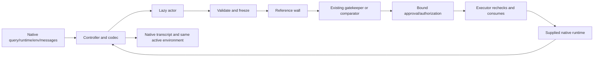

# AgentDojo black box implementation handoff

Prepared 2026-10-15. **Code/configuration preparation only.** Implemented source is
not a claim of runtime readiness, safety, utility or performance.

## Subsequent testing and Colab preparation

The user subsequently supplied Windows Python 3.12.10 pytest output showing
**68 passed in 11.23s**, with a non-fatal pytest-cache permission warning. This
supersedes the original implementation-phase NOT RUN status for those CPU tests.
The Colab helper and runbook were added afterward. Seven new helper tests passed
locally; they mock subprocess/GPU behavior and cover resource rejection, bound
server flags, explicit raw-log selection, and server cleanup on startup failure.
The helper's Colab package installation, asset downloads, and real-model execution
have not been performed here. The original phase records below remain historical.
See `docs/COLAB_RUNBOOK.md` for the separate Linux dependency profile and limits.

## Current branch cleanup

At the user's request, this branch's working tree now omits 22 standalone Laya
prototype artifacts: five `benchmarks/development` snapshots, two `data` fixtures,
the `examples/read-file.json` demo, `gatekeeper/__main__.py`, seven old evaluation
scripts, `scripts/__init__.py`, and five old root-level tests. The `gatekeeper/`
runtime core, model manifest, prompts, dependency pins, and AgentDojo integration
remain. The root README now describes the current black box and its code areas;
`docs/CODE_MAP.md` gives a file-level guide.
No other branch, commit, or Git history was altered. The deleted artifacts remain
available at the earlier `feature/laya-gatekeeper` commit. The inventory and
checks below describe the original implementation phase except where updated.
After cleanup, the source-only reviewer again parsed 39 Python files and 6
configuration JSON files, found one native dispatch site in
`blackbox/execution.py`, and confirmed retained Laya prompts/state/model metadata
and dependency pins still match HEAD. No application imports, tests, or runtime
episodes were executed. The current branch is still `feature/agentdojo-blackbox`.

## A. Repository and branch

- Root: `D:\grids_workspace\permission-that-learn-repo`.
- Starting branch: `feature/laya-gatekeeper`.
- Base and unchanged HEAD: `cdde8b93caa050897ed0d024e1a198a0e14c6d54`.
- New active branch: `feature/agentdojo-blackbox` — **IMPLEMENTED**.
- The starting working tree was clean. No pre-existing changes were overwritten.
- No alternate worktree was needed; the existing branch already contained Laya.
- No applicable `AGENTS.md` was found in the repository or checked ancestor paths.
- Read the external implementation brief, `PROJECT_CONTEXT.md`, current gatekeeper
  roadmap, README, schemas/validation, model state/prompts, policy, worker lifecycle,
  model manifest and dependency metadata.
- Inspected local Git history/branches and sanitized remote identity:
  `https://github.com/AtharvaThorat/permission-that-learn-.git`.
- `.git` and some existing paths required sandbox write approval. Branch creation
  and the required file writes were authorized; no execution authorization was
  inferred from those approvals.
- No commit, push, merge, PR, stash, or reset was performed. The later cleanup
  described above removed only obsolete files from this branch's working tree.

## B. What was implemented

The public `blackbox.build_agentdojo_pipeline(config, dependencies=None)` factory
returns a native AgentDojo pipeline with a meaningful mode name. Construction is
lazy with respect to HTTP/model initialization. `blackbox.cli` provides offline
configuration inspection/preflight, and `integrations.agentdojo.runner` delegates
selected clean/attacked tasks to the native benchmark functions.



Concrete components:

- Strict config and immutable action snapshots, JSON validation, per-episode state,
  explicit budgets and fail-closed error handling.
- Lazy connection-reusing OpenAI-compatible HTTP actor for Qwen3-8B; non-streaming
  structured calls, explicit endpoint/served model/key environment variable,
  request size/time/retry limits, non-thinking extension and no provider fallback.
- Reference deterministic wall enforcing configured effects, exact recipients,
  resource scopes, labels and confirmation requirements. This is **not the wall
  teammate's authoritative implementation**.
- Reviewed mapping for 24 native workspace tool names, including compound writes
  and notifications. Metadata resolution uses declared identities/fields and a
  provenance-labeled sidecar, not evaluator labels or whole environment dumps.
- Existing original Laya/single-question gate reused through an adapter. The one
  existing-package change adds an optional request validator to `Gatekeeper`; its
  default validation, prompts, selection policy and lifecycle remain in place.
  Native arguments are validated against actual schemas rather than renamed into
  lossy prototype actions. The model has not been evaluated on this native schema.
- Single guarded dispatch site, controller-owned authorization ledger, exact
  action/policy/state/schema/expiry rechecks, single-use consumption and same-attempt
  deduplication. Changed actions cannot reuse authorization; distinct equal actions
  are not collapsed merely because their digests match.
- Pending and scripted approval providers, no model-text approval authority,
  sequential per-call mediation, cancelled batch results and honest terminal text.
- Native text-block codec, preserved tool-result content/formatting, call-ID
  validation/generation, no unguarded framework executor in the controller.
- Redacted JSONL events, run-manifest schema/provenance, official scores plus
  execution/ASK/cancellation counters. Independent-label metrics stay null.
- Four explicit modes: unprotected simulation, wall-only, wall+Laya and separately
  labeled wall+rules. Learning is rejected; no fallback switches modes.
- Future setup/server scripts, concrete config/policy examples, environment guide,
  synthetic tests and acceptance targets, and five required handoff documents.

## C. AgentDojo request/response mapping

Selected inspected source: upstream commit
`089ed468cf3ed0322acc66b0211f26d9d90dbf60`, distribution metadata `0.1.35`, Python
requirement `>=3.10`, benchmark `v1.2.2`, suite `workspace`. No native package was
installed or imported during this phase. Exact source file hashes/links are in
`AGENTDOJO_SOURCE_INSPECTION.json`; details are in `AGENTDOJO_COMPATIBILITY.md`.

`query(query, runtime, env, messages, extra_args)` preserves the authentic query and
the actual supplied runtime/environment. Every structured proposal is intercepted
before `runtime.run_function`. The executor uses exactly the validated frozen
arguments. Native `FunctionCall` proposals and matching tool error/results remain
in the transcript. The full five-part tuple returns, with legitimate mutations and
untouched framework metadata. Pending/error episodes have final status text, not
null silence that triggers the harness's retry loop.

Native scoring is unmodified. Its call-stack extractor counts assistant proposals,
even denied ones. Official scores therefore remain separate from actual dispatch
counts. The second native boolean is injection success on attacked runs; the clean
constant `True` is preserved verbatim but clean attack success is null. The runner
uses the native per-task benchmark functions to avoid the suite wrapper's implicit
extra injection-objective episodes.

## D. Changed files

All new source is **IMPLEMENTED / STATICALLY REVIEWED** to the limited extent in
section F. Test and launch source is written but **NOT RUN**. These statuses do not
assert successful imports or behavioral tests.

| Path | Purpose | Origin | Status |
|---|---|---|---|
| `.env.example` | Credential variable names and offline flags | Created | IMPLEMENTED; STATICALLY REVIEWED |
| `.gitignore` | Ignore future environments and personal config | Modified existing | IMPLEMENTED; STATICALLY REVIEWED |
| `README.md` | Current black box overview, code map, and next steps | Modified existing | IMPLEMENTED; STATICALLY REVIEWED |
| `blackbox/__init__.py` | Core guarded runtime, configuration, audit or public entry point | Created | IMPLEMENTED; STATICALLY REVIEWED |
| `blackbox/actions.py` | Core guarded runtime, configuration, audit or public entry point | Created | IMPLEMENTED; STATICALLY REVIEWED |
| `blackbox/actors/__init__.py` | Actor protocol, lazy HTTP client or explicit test double | Created | IMPLEMENTED; STATICALLY REVIEWED |
| `blackbox/actors/base.py` | Actor protocol, lazy HTTP client or explicit test double | Created | IMPLEMENTED; STATICALLY REVIEWED |
| `blackbox/actors/openai_compatible.py` | Actor protocol, lazy HTTP client or explicit test double | Created | IMPLEMENTED; STATICALLY REVIEWED |
| `blackbox/actors/scripted.py` | Actor protocol, lazy HTTP client or explicit test double | Created | IMPLEMENTED; STATICALLY REVIEWED |
| `blackbox/audit.py` | Core guarded runtime, configuration, audit or public entry point | Created | IMPLEMENTED; STATICALLY REVIEWED |
| `blackbox/cli.py` | Core guarded runtime, configuration, audit or public entry point | Created | IMPLEMENTED; STATICALLY REVIEWED |
| `blackbox/config.py` | Core guarded runtime, configuration, audit or public entry point | Created | IMPLEMENTED; STATICALLY REVIEWED |
| `blackbox/contracts.py` | Core guarded runtime, configuration, audit or public entry point | Created | IMPLEMENTED; STATICALLY REVIEWED |
| `blackbox/controller.py` | Core guarded runtime, configuration, audit or public entry point | Created | IMPLEMENTED; STATICALLY REVIEWED |
| `blackbox/execution.py` | Core guarded runtime, configuration, audit or public entry point | Created | IMPLEMENTED; STATICALLY REVIEWED |
| `blackbox/factory.py` | Core guarded runtime, configuration, audit or public entry point | Created | IMPLEMENTED; STATICALLY REVIEWED |
| `blackbox/manifest.py` | Core guarded runtime, configuration, audit or public entry point | Created | IMPLEMENTED; STATICALLY REVIEWED |
| `blackbox/permissions/__init__.py` | Wall, metadata interface, gate adapter, approvals or binding ledger | Created | IMPLEMENTED; STATICALLY REVIEWED |
| `blackbox/permissions/approvals.py` | Wall, metadata interface, gate adapter, approvals or binding ledger | Created | IMPLEMENTED; STATICALLY REVIEWED |
| `blackbox/permissions/bindings.py` | Wall, metadata interface, gate adapter, approvals or binding ledger | Created | IMPLEMENTED; STATICALLY REVIEWED |
| `blackbox/permissions/facts.py` | Wall, metadata interface, gate adapter, approvals or binding ledger | Created | IMPLEMENTED; STATICALLY REVIEWED |
| `blackbox/permissions/gatekeeper_adapter.py` | Wall, metadata interface, gate adapter, approvals or binding ledger | Created | IMPLEMENTED; STATICALLY REVIEWED |
| `blackbox/permissions/rules.py` | Wall, metadata interface, gate adapter, approvals or binding ledger | Created | IMPLEMENTED; STATICALLY REVIEWED |
| `blackbox/permissions/wall.py` | Wall, metadata interface, gate adapter, approvals or binding ledger | Created | IMPLEMENTED; STATICALLY REVIEWED |
| `blackbox/state.py` | Core guarded runtime, configuration, audit or public entry point | Created | IMPLEMENTED; STATICALLY REVIEWED |
| `configs/blackbox/ACTOR_SERVER_ENVIRONMENT.md` | Explicit mode, policy, metadata or future server configuration | Created | IMPLEMENTED; NOT RUN |
| `configs/blackbox/actor-server.env.example` | Explicit mode, policy, metadata or future server configuration | Created | IMPLEMENTED; NOT RUN |
| `configs/blackbox/policies/workspace_example.json` | Explicit mode, policy, metadata or future server configuration | Created | IMPLEMENTED; NOT RUN |
| `configs/blackbox/policies/workspace_metadata.json` | Explicit mode, policy, metadata or future server configuration | Created | IMPLEMENTED; NOT RUN |
| `configs/blackbox/unprotected.json` | Explicit mode, policy, metadata or future server configuration | Created | IMPLEMENTED; NOT RUN |
| `configs/blackbox/wall_gatekeeper.json` | Explicit mode, policy, metadata or future server configuration | Created | IMPLEMENTED; NOT RUN |
| `configs/blackbox/wall_only.json` | Explicit mode, policy, metadata or future server configuration | Created | IMPLEMENTED; NOT RUN |
| `configs/blackbox/wall_rules.json` | Explicit mode, policy, metadata or future server configuration | Created | IMPLEMENTED; NOT RUN |
| `docs/AGENTDOJO_COMPATIBILITY.md` | Implementation handoff, contracts, compatibility or provenance | Created | STATICALLY REVIEWED |
| `docs/AGENTDOJO_SOURCE_INSPECTION.json` | Implementation handoff, contracts, compatibility or provenance | Created | STATICALLY REVIEWED |
| `docs/BLACKBOX_ARCHITECTURE.md` | Implementation handoff, contracts, compatibility or provenance | Created | STATICALLY REVIEWED |
| `docs/BLACKBOX_CONTRACTS.md` | Implementation handoff, contracts, compatibility or provenance | Created | STATICALLY REVIEWED |
| `docs/CODE_MAP.md` | File-level guide to retained runtime and new integration | Created during branch cleanup | STATICALLY REVIEWED |
| `docs/BLACKBOX_IMPLEMENTATION_REPORT.md` | Implementation handoff, contracts, compatibility or provenance | Created | STATICALLY REVIEWED |
| `docs/BLACKBOX_RUNBOOK.md` | Implementation handoff, contracts, compatibility or provenance | Created | STATICALLY REVIEWED |
| `docs/schemas/run_manifest.schema.json` | Implementation handoff, contracts, compatibility or provenance | Created | STATICALLY REVIEWED |
| `gatekeeper/policy.py` | Optional native request-validation seam; default semantics retained | Modified existing | IMPLEMENTED; STATICALLY REVIEWED |
| `integrations/__init__.py` | Native pipeline, message codec, workspace mapping or benchmark runner | Created | IMPLEMENTED; STATICALLY REVIEWED |
| `integrations/agentdojo/__init__.py` | Native pipeline, message codec, workspace mapping or benchmark runner | Created | IMPLEMENTED; STATICALLY REVIEWED |
| `integrations/agentdojo/codec.py` | Native pipeline, message codec, workspace mapping or benchmark runner | Created | IMPLEMENTED; STATICALLY REVIEWED |
| `integrations/agentdojo/context.py` | Native pipeline, message codec, workspace mapping or benchmark runner | Created | IMPLEMENTED; STATICALLY REVIEWED |
| `integrations/agentdojo/pipeline.py` | Native pipeline, message codec, workspace mapping or benchmark runner | Created | IMPLEMENTED; STATICALLY REVIEWED |
| `integrations/agentdojo/runner.py` | Native pipeline, message codec, workspace mapping or benchmark runner | Created | IMPLEMENTED; STATICALLY REVIEWED |
| `integrations/agentdojo/tools.py` | Native pipeline, message codec, workspace mapping or benchmark runner | Created | IMPLEMENTED; STATICALLY REVIEWED |
| `requirements-blackbox-test.txt` | Proposed lightweight native-contract test dependencies | Created | IMPLEMENTED; STATICALLY REVIEWED |
| `requirements-blackbox.txt` | Proposed CPU integration dependencies | Created | IMPLEMENTED; STATICALLY REVIEWED |
| `scripts/serve_blackbox_actor.sh` | Future setup or local actor launch | Created | NOT RUN (source reviewed) |
| `scripts/setup_blackbox.ps1` | Future setup or local actor launch | Created | NOT RUN (source reviewed) |
| `scripts/static_blackbox_review.py` | Source-only AST/JSON/Git reviewer | Created | STATICALLY REVIEWED |
| `tests/blackbox/ACCEPTANCE_SCENARIOS.md` | Synthetic enforcement/native/lifecycle test source or acceptance specification | Created | NOT RUN (source written) |
| `tests/blackbox/__init__.py` | Synthetic enforcement/native/lifecycle test source or acceptance specification | Created | NOT RUN (source written) |
| `tests/blackbox/helpers.py` | Synthetic enforcement/native/lifecycle test source or acceptance specification | Created | NOT RUN (source written) |
| `tests/blackbox/test_acceptance_scenarios.py` | Synthetic enforcement/native/lifecycle test source or acceptance specification | Created | NOT RUN (source written) |
| `tests/blackbox/test_actor_transport.py` | Synthetic enforcement/native/lifecycle test source or acceptance specification | Created | NOT RUN (source written) |
| `tests/blackbox/test_config_lifecycle.py` | Synthetic enforcement/native/lifecycle test source or acceptance specification | Created | NOT RUN (source written) |
| `tests/blackbox/test_enforcement.py` | Synthetic enforcement/native/lifecycle test source or acceptance specification | Created | NOT RUN (source written) |
| `tests/blackbox/test_native_contract.py` | Synthetic enforcement/native/lifecycle test source or acceptance specification | Created | NOT RUN (source written) |
| `tests/blackbox/test_workspace_facts.py` | Synthetic enforcement/native/lifecycle test source or acceptance specification | Created | NOT RUN (source written) |

## E. Policy and model configuration

- Actor: `Qwen/Qwen3-8B`, served name `Qwen3-8B`, explicit loopback-compatible
  endpoint, temperature 0.7, top-p 0.8, output limit 2048, thinking disabled via
  `chat_template_kwargs`. Actor revision/local path/template/server/quantization
  remain user-supplied and unverified; no SHA or GPU capacity was invented.
- Gatekeeper: original `convaiinnovations/laya` revision
  `7b928d828b7b0e022f929d9bd2e44165aa270148`, `single-v1`, CPU. The experimental
  typed revision `e929ae5cf69bc34259cd2f95c9e91145b818b1f0` is preserved separately,
  not substituted. Offline flags and an existing pinned cache snapshot are required.
  Encoder/tokenizer dependencies are not independently repinned here.
- Wall: project reference implementation. Destructive/authority writes denied;
  outgoing/file/calendar writes require confirmation. Recipient allowlists start
  empty. No resource labels are fabricated in the example sidecar.
- Budgets: 15 actor turns, 30 evaluated calls, 10 total denials, 2 identical
  denials, 600-second episode, 30-second tool elapsed limit, 120-second actor
  request timeout, 30-second gate inference timeout, 300-second Laya load timeout,
  300-second authorization TTL. These are proposed defaults, not measured settings.
- Character budgets: 100,000 actor context, 24,000 gate input, 32,000 action;
  no silent truncation and no arbitrary calibrated confidence threshold.
- Default ASK is terminal pending. Pending descriptions/bindings survive in
  `last_episode` memory with redacted audit records; durable persistence/resume is
  **DEFERRED**, not advertised.
- Unknown guarded tool effects, nested executable objects, unsupported content
  blocks and unsupported attachment metadata fail explicitly. Event attachments
  need a future reviewed facts mapping; ordinary file attachments are resolved.
- Learning, fine-tuning, real-tool adapters and automatic provider fallback are off.

## F. Checks actually performed

Only read-only inspection, source writing and static checks occurred:

| Actual check/action | Outcome |
|---|---|
| `git status --short`, `git branch --show-current`, `git rev-parse HEAD`, branch/history inspection | Clean initial tree; correct Laya base; new branch recorded above |
| `git switch -c feature/agentdojo-blackbox` | Initial sandbox write denied; approved retry created branch |
| `Get-Content`, `rg`, directory/package-file inspection | Read project contracts, historical metadata and applicable context; no local AgentDojo installation found |
| GitHub commit API and pinned raw source requests | 25 source/metadata files retrieved for inspection; no packages/model assets fetched; an exploratory nonexistent `attacks/fixed_injections.py` request returned 404 and was not used |
| Official Qwen model-card/function-calling documentation reads | Confirmed profile/template/request guidance; server compatibility still unverified |
| Python `ast.parse` over source text and `json.loads` over config text | Parsed successfully; no application imports or test collection |
| `python scripts/static_blackbox_review.py` | Original source-only run found one native dispatch call site; this checker was later updated for the cleanup |
| PowerShell parser API on `scripts/setup_blackbox.ps1` | Syntax parsed; script not executed |
| `git diff --check` | Passed; Git noted ordinary CRLF-to-LF normalization for `.gitignore` |
| `git diff --exit-code HEAD -- gatekeeper/questions.py gatekeeper/state.py gatekeeper/model_manifest.json requirements.txt requirements-lock.txt requirements-test.txt` | Retained prompts/model pins/dependencies unchanged; old fixture/snapshot paths intentionally deleted afterward |
| Manual import-time/fallback/binding/dispatch review; AST duplicate-field/key scan | Reviewed static control flow and corrected duplicate patch fragments; no behavioral verification implied |

Final source counts will be filled from the last permitted static inspection:
- 39 Python files parsed (new modules/tests, modified policy, static reviewer).
- 6 configuration JSON files plus 2 documentation JSON files parsed.
- Exactly one `run_function` call in application source: `blackbox/execution.py`.
- 54 written test function definitions; parameterized instances not collected or run.
- Duplicate class members, dictionary keys and adjacent statements: no remaining findings.

The tests cover E01–E20 and A01–A13 through counter-based synthetic assertions,
plus configuration, local-asset failure, lifecycle, HTTP transport, metadata and
native schema/default behavior. All written test functions are **NOT RUN**. No
historical test result is presented as a result from this branch.

## G. What was deliberately not run

| Work | Status |
|---|---|
| Package installation/upgrades/resolver or setup scripts | NOT RUN |
| Model/adapter/tokenizer asset downloads | NOT RUN |
| Model loading, Laya warm-up, inference or endpoint probing | NOT RUN |
| Application imports, CLI preflight, demos or mock episodes | NOT RUN |
| Test collection and test suite | NOT RUN |
| AgentDojo clean/attacked benchmark episodes | NOT RUN |
| vLLM/HTTP servers, workers, containers, notebooks | NOT RUN |
| GPU reservations/jobs/SLURM submission | NOT RUN |
| Fine-tuning, training, online learning or calibration | NOT RUN |
| Real email/calendar connections | NOT RUN |

## H. Remaining setup and blockers

Runtime verification is **BLOCKED pending later setup/execution**, not blocked from
further source work: install the prepared dependencies in an isolated environment;
resolve any actual conflicts without silently changing historical pins; supply
local actor/Laya assets and all encoder/tokenizer dependencies; select the exact
actor revision/server/CUDA/template combination; set the local endpoint key;
configure real task/injection/vector IDs and reviewed policy metadata; run the
offline preflight and then the written tests before a selected benchmark.

The teammate wall integration is **DEFERRED** behind the wall/facts seams. A real
model evaluation is still needed to establish Laya's performance with native tool
names and the actor's tool-call parsing. No endpoint was contacted and no assets
were exhaustively searched or certified present. Native imports/dependency
compatibility, runtime safety and utility all remain unverified.

## I. Exact next commands (later user execution only)

Replace every placeholder first. The detailed asset/config/policy commands are in
`BLACKBOX_RUNBOOK.md`. These commands match implemented entry points; no run-all
command is provided.

1. Install the prepared CPU dependencies in a fresh environment:

   ```powershell
   .\scripts\setup_blackbox.ps1 -Python '<ABSOLUTE_PATH_TO_SELECTED_PYTHON.exe>'
   $BBPython = (Resolve-Path '.venv-blackbox\Scripts\python.exe').Path
   & $BBPython -m pip check
   ```

2. Copy a personal config, supply existing model/cache paths, exact revision,
   template/server details, one real user-task ID and reviewed policy metadata:

   ```powershell
   Copy-Item configs\blackbox\wall_gatekeeper.json configs\blackbox\experiment.local.json
   $env:HF_HUB_OFFLINE = '1'
   $env:TRANSFORMERS_OFFLINE = '1'
   $env:BLACKBOX_ACTOR_API_KEY = '<LOCAL_SERVER_KEY>'
   ```

3. In the separately prepared Linux server environment, start the local model:

   ```bash
   bash scripts/serve_blackbox_actor.sh /absolute/existing/Qwen3-8B Qwen3-8B '<EXACT_VLLM_VERSION>'
   ```

4. Run offline readiness inspection (no endpoint/model loading):

   ```powershell
   & $BBPython -m blackbox.cli preflight --config configs\blackbox\experiment.local.json
   ```

5. After execution is authorized, run the written tests:

   ```powershell
   & $BBPython -m pytest tests\blackbox -q
   ```

6. Run one explicitly selected clean task:

   ```powershell
   & $BBPython -m integrations.agentdojo.runner --config configs\blackbox\experiment.local.json --native-raw-logs
   ```

7. Prepare `attacked.local.json` and `attack.local.json` as in the runbook with the
   same user-task ID, one injection-task ID and explicit native vector payload,
   then run the protected attacked comparison:

   ```powershell
   & $BBPython -m integrations.agentdojo.runner --config configs\blackbox\attacked.local.json --native-raw-logs
   ```

Copy the resolved config and change only `mode` for wall-only/unprotected/rules
comparisons. Preserve actor settings, limits, policy and selections across modes.

## J. Known limitations and readiness

- No runtime verification in this phase. Syntax checks cannot establish behavior.
- Laya remains an experimental, uncalibrated classifier with historical over-allows;
  no new accuracy or calibrated-risk guarantee is claimed.
- Reference wall only; authoritative teammate policy/labels still need integration.
- No training, fine-tuning, approval learning or real email/calendar integration.
- Nested native executable calls and thinking/multimodal blocks unsupported.
- Guarded event attachments and unknown tool effects require further mapping.
- Pending episodes terminate; no durable approval continuation or cross-process
  idempotency. The ledger is in memory; exactly-once crash recovery is not promised.
- Synchronous native tool timeouts are cooperative pre/post checks; they cannot
  interrupt a hung Python tool safely. Concurrent use is unsupported.
- Tool permission enforcement does not guarantee final-text correctness/disclosure.
- Native trace scoring may count denied proposals; actual execution is separate.
- Unauthorized-ALLOW/false-block metrics require independent labels; executed wall
  violations require trace review. No numerical benchmark results were fabricated.
- Native raw synthetic logs require explicit opt-in; the default audit stores
  hashes/categories. Trusted Python dependencies/providers are outside this boundary.

The implementation and configuration have been prepared and statically reviewed
to the extent listed above. Model assets have not been downloaded, and the system,
tests, and benchmarks have not been executed. Runtime readiness remains conditional
on the listed setup steps and verification.
