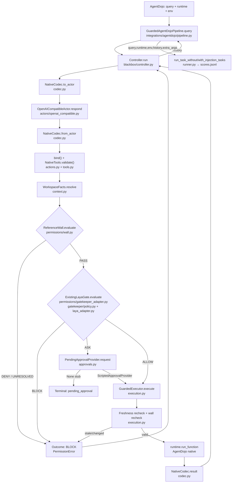

# Repository Status Audit — Permissions That Learn
**Audit timestamp:** 2026-10-19 21:02:00 PDT (2026-10-20T04:02:00Z)  
**Prepared by:** Read-only automated audit (no code or branch state modified)  
**Repository root:** `D:\grids_workspace\permission-that-learn-repo`  
**Remote identity:** `https://github.com/AtharvaThorat/permission-that-learn-.git` (credentials redacted)

> [!IMPORTANT]
> Remote-tracking refs reflect the last `git fetch`. No fetch was performed during this audit. Remote tip SHAs may be stale. All branch comparisons are local-only.

---

## A. Executive Assessment

### What we currently have

Four branches (two local, two remote-only) containing three distinct bodies of work that have **never been merged into `main`**:

1. **`feature/agentdojo-blackbox`** (current HEAD, `f811b95`) — The most complete artifact. A full guarded-pipeline stack: OpenAI-compatible actor, reference deterministic wall, Laya gatekeeper adapter, guarded executor, authorization ledger, AgentDojo `BasePipelineElement` implementation, a benchmark runner, and 84+ CPU tests. This is Siddharth's integration branch. It also absorbed the Laya gatekeeper runtime from `feature/laya-gatekeeper`.

2. **`origin/feature/wall`** (`6c25779`) — Atharva's standalone Wall package (`ptl.wall`): 107 unit/contract/property tests, labeled tool inventory, `WallContext`, `HarnessWall` adapter, and 504-line AgentDojo replay benchmark JSONL. This is a **separate Python package** that is not yet imported by the blackbox branch. It has a `HarnessWall` adapter designed to plug into the blackbox harness, but the wiring does not exist in either branch.

3. **`origin/feature/agentdojo-local-benchmark`** (`2c254cf`) — Kaustubh's standalone baseline benchmark (NIM phases 1–5 + local Colab phase 6 for Llama/Qwen2.5/Qwen3). Uses AgentDojo's stock `ToolsExecutor` pipeline with no permission layer. Produces baseline attack-success rates for unprotected models. Not connected to the blackbox pipeline.

4. **`main`** (`be8a7bd`) — One commit: the initial README stub. Nothing else.

### What actually has supporting run evidence

| Evidence item | Type | Branch | Status |
|---|---|---|---|
| Laya gatekeeper on 20 smoke cases: **14/20 correct (70%)**, 7/15 semantic (47%) | Real Laya inference on CPU | `feature/laya-gatekeeper` | Confirmed from `benchmarks/development/verification.json` |
| 84 CPU blackbox tests passing in 7.09 s (author) | Mock/scripted execution | `feature/agentdojo-blackbox` | Reported in `docs/BLACKBOX_IMPLEMENTATION_REPORT.md` |
| 68 CPU blackbox tests passing in 11.23 s (user, Windows Python 3.12.10) | Mock/scripted execution | `feature/agentdojo-blackbox` | Reported in `docs/BLACKBOX_IMPLEMENTATION_REPORT.md` |
| 40-task Colab clean run: **0/40 utility**, 9 ALLOW dispatches, 22 Laya truncation errors | Real Qwen + real Laya on Colab GPU | `feature/agentdojo-blackbox` | Confirmed from `docs/COLAB_40_TASK_RESULTS.md` |
| 504-line Wall JSONL replay labels on AgentDojo ground truth | Scripted replay, no actor/Laya | `origin/feature/wall` | Confirmed from `wall/benchmarks/agentdojo_workspace_v1.2.2_wall_labels.jsonl` |
| Wall: 107 unit/property tests (CI passing per README) | Test source exists; CI claimed | `origin/feature/wall` | README claims "passing CI"; not independently run here |
| Phase 6 local baseline (Llama 3.1-8B, Qwen2.5-3B, Qwen3-8B) | Real model inference, Colab | `origin/feature/agentdojo-local-benchmark` | Notebook has 13 output cells; numbers cited in README |

### What remains disconnected or incomplete

- **The Wall (`ptl.wall`) is not imported by the blackbox branch.** `feature/agentdojo-blackbox` has its own `ReferenceWall` in `blackbox/permissions/wall.py`, explicitly labeled `NOT the wall teammate's authoritative policy`. The `HarnessWall` adapter exists on `feature/wall` but has never been wired in.
- **No full end-to-end run with the combined stack has succeeded.** The 40-task Colab run demonstrated pipeline operation but achieved 0/40 utility and had 22 Laya truncation failures. The injection pilot (`COLAB_INJECTION_RUN.md`) is documented but explicitly marked not yet run.
- **Approval/learning is absent.** `learning_enabled` is hardcoded `Literal[False]` in `Config`. `PendingApprovalProvider.request()` always returns `None` (stops episode immediately).
- **The local-benchmark branch is entirely separate** from the permission system — it measures unprotected baselines only.
- **`main` is functionally empty** — it contains only a README stub and has never received any of the above work.

### Main blocker to a working protected AgentDojo demonstration

**The Laya gatekeeper truncates on collection-read metadata for ~55% of tasks (22/40 in the clean run).** When Laya rejects a response, the controller falls back to `ASK`, which with the current `PendingApprovalProvider` immediately terminates the episode with `pending_approval`. This means any task requiring email, file listing, or calendar collection reads cannot be completed by the protected pipeline in its current state. Secondary blockers: (a) `ptl.wall` is not integrated, (b) no GPU run of the injection pilot has been completed.

---

## B. Audit Scope and Limitations

| Item | Detail |
|---|---|
| **Local refs inspected** | `refs/heads/main`, `refs/heads/feature/laya-gatekeeper`, `refs/heads/feature/agentdojo-blackbox`, `refs/remotes/origin/HEAD`, `refs/remotes/origin/main`, `refs/remotes/origin/feature/laya-gatekeeper`, `refs/remotes/origin/feature/agentdojo-blackbox`, `refs/remotes/origin/feature/wall`, `refs/remotes/origin/feature/agentdojo-local-benchmark` |
| **Local branches** | 3 (main, feature/laya-gatekeeper, feature/agentdojo-blackbox) |
| **Remote-only tips** | 2 (origin/feature/wall @ 6c25779, origin/feature/agentdojo-local-benchmark @ 2c254cf) |
| **Worktrees** | 1 (root only; no additional worktrees) |
| **Working tree** | Clean; no staged, modified, or untracked files recorded by `git status` |
| **No tests executed** | All test counts come from documentation or commit messages, not this audit's execution |
| **No models loaded** | Laya inference results are from stored artifacts, not this audit |
| **Stale remote refs** | No `git fetch` was performed; remote SHAs may not reflect GitHub HEAD |
| **Notebook outputs** | Examined cell output count (13 for local-benchmark notebook); raw numeric results cited from README |
| **Large files skipped** | Virtual environments, model weights, lockfile transitive pins beyond the key entries |
| **AGENTS.md** | Not found in repository root or inspected ancestors |

---

## C. Branch Inventory

| Branch | Type | Tip SHA | Date | Author | Purpose | Merged to main? |
|---|---|---|---|---|---|---|
| `main` | local + remote | `be8a7bd` | 2026-10-06 | AtharvaThorat | Repo init, README stub only | — (is main) |
| `feature/laya-gatekeeper` | local + remote | `cdde8b9` | 2026-10-07 | Siddharth-magesh | Laya gatekeeper prototype + 20-case smoke eval | No |
| `feature/agentdojo-blackbox` | local + remote (same SHA) | `f811b95` | 2026-10-16 | Siddharth-magesh | Full guarded pipeline, AgentDojo integration, Colab runner | No |
| `origin/feature/wall` | remote-only | `6c25779` | 2026-10-15 | Atharva Thorat | `ptl.wall` package: tool labels, context, policy, harness adapter | No |
| `origin/feature/agentdojo-local-benchmark` | remote-only | `2c254cf` | 2026-10-16 | kashinadhe | Unprotected baseline benchmark (NIM + local models) | No |

### Branch lineage

```
be8a7bd  (main, origin/main, origin/HEAD)
    └── cdde8b9  (feature/laya-gatekeeper, origin/feature/laya-gatekeeper)
            ├── f811b95  (feature/agentdojo-blackbox, origin/feature/agentdojo-blackbox)  ← HEAD
            └──  [origin/feature/wall branches from be8a7bd independently]
            └──  [origin/feature/agentdojo-local-benchmark branches from be8a7bd independently]
```

**`feature/agentdojo-blackbox`** has 4 unique commits on top of `feature/laya-gatekeeper`:
- `34ef73c` — Refactor tests: new blackbox workspace-facts tests, remove obsolete tests
- `8a5b3a3` — Colab benchmark notebook and scripts for Qwen actor evaluation
- `2ef9f93` — Enhance gatekeeper diagnostics and semantic model handling
- `f811b95` — Add injection pilot and related configurations for AgentDojo

**`origin/feature/wall`** (7 commits) and **`origin/feature/agentdojo-local-benchmark`** (9 commits) both branch from `main` (`be8a7bd`) and are entirely independent of each other and of the laya/blackbox line.

**Remote duplicate check:** `feature/agentdojo-blackbox` local tip == `origin/feature/agentdojo-blackbox` tip (`f811b95`). `feature/laya-gatekeeper` local == remote (`cdde8b9`). `main` local == remote (`be8a7bd`). No local branch is ahead or behind its remote.

---

## D. Component Status Matrix

| # | Component | Status | Branch / Path | Verification Evidence | Integration Status | Missing Work |
|---|---|---|---|---|---|---|
| 1 | **Acting LLM / OpenAI-compatible actor** | Substantially implemented, unverified end-to-end | `feature/agentdojo-blackbox` → `blackbox/actors/openai_compatible.py` | 40-task Colab run recorded actor calls; 0/40 utility due to gatekeeper blocks | Present in pipeline; requires vLLM serving Qwen3-8B | Qwen revision not pinned in config; Colab run had infrastructure_error on first attempt |
| 2 | **Model/checkpoint config** | Substantially implemented | `feature/agentdojo-blackbox` → `blackbox/config.py`, `gatekeeper/model_manifest.json` | Laya checkpoint `convaiinnovations/laya@7b928d8` pinned; Qwen3-8B named but revision null | Config validated; weights not local | Actor model_revision is null (not pinned to exact commit) |
| 3 | **Agent/controller loop** | Substantially implemented, unverified | `feature/agentdojo-blackbox` → `blackbox/controller.py` | 68/84 CPU tests via scripted actors | Integrated | ASK handling terminates episode (no real approval provider) |
| 4 | **Native AgentDojo pipeline adapter** | Substantially implemented, unverified | `feature/agentdojo-blackbox` → `integrations/agentdojo/pipeline.py` | CPU injection test (`test_injection_pilot.py`) exercises full path with scripted actor | Integrated | Runtime compatibility NOT verified (no install/import during audit) |
| 5 | **Native message conversion / tool-call parsing** | Substantially implemented | `feature/agentdojo-blackbox` → `integrations/agentdojo/codec.py` | CPU tests cover decode/encode paths | Integrated | Thinking/multimodal blocks unsupported by design |
| 6 | **Tool-effect registry and argument validation** | Substantially implemented | `feature/agentdojo-blackbox` → `integrations/agentdojo/tools.py` | 24 workspace tools labeled in `EFFECTS` dict; Pydantic validation covered by tests | Integrated | Unknown tools raise in guarded mode; effects list is hand-authored |
| 7 | **Hard wall (reference)** | Substantially implemented | `feature/agentdojo-blackbox` → `blackbox/permissions/wall.py` | CPU enforcement tests; Colab run shows DENY for attacker email | Integrated (reference only) | **`ptl.wall` (authoritative) not integrated**; reference wall labeled as stand-in |
| 7b | **Hard wall (authoritative `ptl.wall`)** | Implemented with identified verification evidence | `origin/feature/wall` → `wall/src/ptl/wall/` | 107 tests (CI claimed passing); 504-line replay JSONL | **Not integrated** into blackbox pipeline | `HarnessWall` adapter exists but not wired to `feature/agentdojo-blackbox` |
| 8 | **Trusted resource facts / workspace metadata** | Substantially implemented | `feature/agentdojo-blackbox` → `integrations/agentdojo/context.py` | CPU tests in `test_workspace_facts.py` | Integrated | Labels come from sidecar JSON only; no dynamic labeling |
| 9 | **Laya gatekeeper API, prompts, worker lifecycle** | Implemented with identified verification evidence | `feature/agentdojo-blackbox` → `gatekeeper/laya_adapter.py`, `gatekeeper/policy.py` | Real Laya inference: 14/20 correct on 20 smoke cases (CPU); 40-task Colab run | Integrated; uses `convaiinnovations/laya@7b928d8` | Requires local cache at exact HF snapshot path; OFFLINE env vars mandatory |
| 10 | **Other gatekeeper backends / comparators** | Substantially implemented | `feature/agentdojo-blackbox` → `blackbox/permissions/rules.py` | CPU tests cover `RulesGate` | Integrated as `wall_rules` mode | `RulesGate` is coarse (read=ALLOW, write=ASK); not a semantic gate |
| 11 | **Final ALLOW/ASK/BLOCK enforcement** | Substantially implemented | `feature/agentdojo-blackbox` → `blackbox/controller.py` (mediate method) | CPU enforcement tests E01–E20 cover all code paths | Integrated | Enforcement logic verified via scripted actors, not real Laya+Qwen |
| 12 | **Guarded executor and interception** | Substantially implemented | `feature/agentdojo-blackbox` → `blackbox/execution.py` | CPU tests E05–E08, E15–E17; only one `runtime.run_function` call site | Integrated | No bypass path found in source |
| 13 | **Exact-action binding, freshness, duplicate prevention** | Substantially implemented | `feature/agentdojo-blackbox` → `blackbox/permissions/bindings.py` | CPU tests E06, E07, E08, E15, E16 | Integrated | TTL and policy/state fingerprinting confirmed in source |
| 14 | **ASK handling and approval provider** | Interface/stub only | `feature/agentdojo-blackbox` → `blackbox/permissions/approvals.py` | CPU tests E04, E05, E09, E10 (scripted approvals) | Integrated (stub) | `PendingApprovalProvider` always returns None → episode terminates; no real approval UI |
| 15 | **Approval memory / learning** | Absent | — | — | Not present | `learning_enabled: Literal[False]`; no learning module exists anywhere |
| 16 | **Clean/attacked benchmark runner** | Substantially implemented | `feature/agentdojo-blackbox` → `integrations/agentdojo/runner.py`, `scripts/benchmark_colab.py` | 40-task Colab clean run completed; injection pilot CPU tests pass | Integrated (clean); attacked Colab run not yet executed | Injection pilot GPU run not completed; `verify_distribution()` checks exact AgentDojo git revision |
| 17 | **Comparison modes** | Substantially implemented | `feature/agentdojo-blackbox` → `blackbox/config.py` | 4 modes: unprotected, wall_only, wall_gatekeeper, wall_rules | Integrated | No cross-mode comparison run has been executed end-to-end |
| 18 | **Logging, manifests, result aggregation** | Substantially implemented | `feature/agentdojo-blackbox` → `blackbox/audit.py`, `blackbox/manifest.py`, `integrations/agentdojo/runner.py` | JSONL audit + scores.jsonl output; manifest schema in `docs/schemas/` | Integrated | scores.jsonl from 40-task run is evidence; raw JSONL traces reviewed but not analyzed here |
| 19 | **Tests and fixtures** | Substantially implemented | `feature/agentdojo-blackbox` → `tests/blackbox/` (11 test files); `origin/feature/wall` → `wall/tests/` (8 test files) | 68–84 CPU tests passing (blackbox); 107 wall tests (CI claimed) | Unmerged | Wall tests not runnable without `ptl` package install |
| 20 | **Dependency/setup scripts** | Partially implemented | `feature/agentdojo-blackbox` → `requirements-blackbox.txt`, `scripts/setup_blackbox.ps1`, `scripts/colab_blackbox.py` | Colab setup executed (75 CPU tests); Windows setup not executed | Present | AgentDojo+vLLM+Laya combined dependency resolution not verified |
| 21 | **Documentation / implementation handoffs** | Substantially implemented | `feature/agentdojo-blackbox` → `docs/` (12 documents) | Implementation report, runbook, architecture, contracts, code map | Current | Some docs describe future commands labeled NOT RUN |

---

## E. Actual Architecture and Execution Path

### Concrete source references for each step

| Step | Concrete location |
|---|---|
| 1. Receive AgentDojo task | `integrations/agentdojo/pipeline.py` → `GuardedAgentDojoPipeline.query(query, runtime, env, messages, extra_args)` |
| 2. Call acting model | `blackbox/actors/openai_compatible.py` → `OpenAICompatibleActor.respond(messages, tools, timeout)` |
| 3. Parse response | `integrations/agentdojo/codec.py` → `NativeCodec.from_actor(response, episode, turn)` |
| 4. Resolve tool arguments / resources | `blackbox/actions.py` → `bind()` + `integrations/agentdojo/tools.py` → `NativeTools.validate()` + `integrations/agentdojo/context.py` → `WorkspaceFacts.resolve()` |
| 5. Evaluate the wall | `blackbox/permissions/wall.py` → `ReferenceWall.evaluate(action)` → `WallVerdict` |
| 6. Call the gatekeeper | `blackbox/permissions/gatekeeper_adapter.py` → `ExistingLayaGate.evaluate(episode, action, wall)` → `gatekeeper/policy.py` → `Gatekeeper.evaluate()` → `gatekeeper/laya_adapter.py` → `LayaBackend.predict()` |
| 7. Handle ASK/BLOCK | `blackbox/controller.py` → `Controller.mediate()`: BLOCK → `Outcome(False, …)`; ASK → `approvals.request(pending)` → if None → `pending_approval` terminal |
| 8. Authorize and execute tool | `blackbox/execution.py` → `GuardedExecutor.execute()` → freshness recheck → `ledger.consume()` → `runtime.run_function()` |
| 9. Return result to model | `integrations/agentdojo/codec.py` → `NativeCodec.result(call, outcome)` → appended to history |
| 10. Return to AgentDojo | `integrations/agentdojo/pipeline.py` → `return query, runtime, env, history, extra_args` |
| 11. Produce scores | `integrations/agentdojo/runner.py` → `run()` → official AgentDojo `run_task_*` functions → `scores.jsonl` |

### Architecture diagram



### Security-relevant findings in the execution path

| Finding | Classification | Evidence |
|---|---|---|
| **Single dispatch site** — `runtime.run_function` is only called from `GuardedExecutor.execute` | Confirmed from source | `blackbox/execution.py` sole location; controller passes `self.executor` |
| **Wall recheck before execution** — `GuardedExecutor` re-evaluates wall freshness and binding digest before consuming authorization | Confirmed from source | `execution.py` lines: `fresh = bind(...)` then digest comparison then `wall.evaluate(fresh)` |
| **ALLOW is never silently granted** — actor text claiming ALLOW has no authority | Confirmed from source | `test_e10_model_approval_text_has_no_authority` in `test_enforcement.py` |
| **ASK does not permit execution** — `PendingApprovalProvider` returns None → episode halts | Confirmed from source | `approvals.py` `PendingApprovalProvider.request` returns `None` always; controller checks for None |
| **Changed arguments after approval rejected** — `Binding.matches` compares digest, policy, state, schema | Confirmed from source | `test_e06_changed_action_rejects_old_authorization` in `test_enforcement.py` |
| **Batch cancellation on non-ALLOW** — remaining batch calls cancelled after first denial | Confirmed from source | `controller.py` `cancel` flag set when `outcome.decision != 'ALLOW'` |
| **No automatic model downloads at import** — `ExistingLayaGate.initialize()` guards offline env vars | Confirmed from source | `gatekeeper_adapter.py`: raises `RuntimeError('OFFLINE_ENV_REQUIRED')` if not set |
| **Ground-truth labels not in Laya input** — `gatekeeper_adapter.py` constructs state from frozen action/facts only | Confirmed from source | State dict in `ExistingLayaGate.evaluate()` contains no AgentDojo scorer/label fields |
| **Nested FunctionCall objects rejected** — `json_value()` rejects non-JSON Python objects recursively | Confirmed from source | `actions.py` `json_value()` raises on any non-JSON type including `FunctionCall` |
| **Laya truncation triggers ASK fallback, not ALLOW** — truncated responses fail closed | Confirmed from source | `laya_adapter.py` `_parse_single_response`: truncation raises ValueError → error path → ASK in controller |
| **Wall version mismatch → DENY** — binding created under old wall version is rejected | Confirmed from source | `ReferenceWall.evaluate()`: `action.policy_version != self.version → DENY 'STALE_POLICY'` |
| **Reference wall ≠ `ptl.wall`** — blackbox uses its own simplified wall, not Atharva's authoritative implementation | Confirmed from source | `blackbox/permissions/wall.py` docstring: "NOT the wall teammate's authoritative policy" |
| **Official trace includes denied proposals** — AgentDojo's `functions_stack_trace_from_messages` counts all proposals including blocked ones | Suspected — documented | `docs/AGENTDOJO_COMPATIBILITY.md` notes this mismatch |

---

## F. Experiment and Verification Inventory

### F1. Laya gatekeeper smoke evaluation (real Laya inference)

| Field | Value |
|---|---|
| **Branch/commit** | `feature/laya-gatekeeper` @ `cdde8b9` |
| **Date** | ~2026-10-07 (inferred from commit) |
| **Actor** | None (gatekeeper-only evaluation) |
| **Gatekeeper** | `convaiinnovations/laya` rev `7b928d8`, CPU, `laya==0.3.28` |
| **Dataset** | 20 hand-authored gatekeeper smoke cases in `data/gatekeeper_smoke_cases.jsonl` |
| **Condition** | Clean (no attacks) |
| **Mode** | Gatekeeper only (no wall, no executor) |
| **Metrics** | Overall accuracy 14/20 (70%), semantic accuracy 7/15 (47%) |
| **Incorrect ALLOW cases** | GK-007, GK-008, GK-009, GK-011, GK-016 |
| **Evidence** | `benchmarks/development/verification.json` (directly inspected) |
| **Type** | Real model inference, CPU |
| **Reproducibility gaps** | Python 3.13.9 environment; not reproduced in blackbox branch environment |

### F2. CPU blackbox test suite

| Field | Value |
|---|---|
| **Branch** | `feature/agentdojo-blackbox` |
| **Author run** | 84 passed in 7.09 s (Linux/Mac) |
| **User run** | 68 passed in 11.23 s (Windows Python 3.12.10); non-fatal pytest-cache permission warning |
| **Coverage** | 20 enforcement tests (E01–E20), acceptance scenarios, native contract, actor transport, config lifecycle, workspace facts, Colab orchestration helpers, injection pilot native scoring |
| **Type** | Mock/scripted execution — no real Laya, no real Qwen, no real AgentDojo environment |
| **Evidence** | Reported in `docs/BLACKBOX_IMPLEMENTATION_REPORT.md` |
| **Note** | Count difference (84 vs 68) explained in report as 7 new helper tests added after user's run |

### F3. 40-task Colab clean run (real Qwen + real Laya)

| Field | Value |
|---|---|
| **Branch** | `feature/agentdojo-blackbox` |
| **Run ID** | `20261016T202328Z-e5e0f3b3` |
| **Date** | 2026-10-16 |
| **Actor** | Qwen3-8B (vLLM, Colab GPU) |
| **Gatekeeper** | Laya `convaiinnovations/laya@7b928d8`, CPU, `wall_gatekeeper` mode |
| **Tasks** | `user_task_0` through `user_task_39`, workspace suite, no injections |
| **Duration** | 770.8 s (12.8 min) |
| **Results** | 0/40 utility; 9 tool dispatches; 43 raw Laya predictions (21 usable); 9 ALLOW, 33 ASK, 1 BLOCK |
| **Key failure** | 22 Laya responses rejected for truncation (email/file collection reads exceeded token budget) |
| **Type** | Real model inference + real Laya; AgentDojo native scoring |
| **Evidence** | `docs/COLAB_40_TASK_RESULTS.md` (directly inspected, table of all 40 tasks) |
| **Note** | Semantic model accuracy not measurable from this run (all ASK → pending_approval) |

### F4. Injection pilot plan (NOT YET EXECUTED on GPU)

| Field | Value |
|---|---|
| **Branch** | `feature/agentdojo-blackbox` |
| **Design** | 5 task/objective pairs × 3 modes (unprotected, wall_only, wall_gatekeeper) × clean+injected = 30 episodes |
| **Attack file** | `configs/blackbox/attacks/workspace_pilot.json` |
| **CPU evidence** | `test_injection_pilot.py` tests pass (scripted actors, no real model) — confirms orchestration and native scoring wiring |
| **GPU run** | Not executed; `COLAB_INJECTION_RUN.md` provides commands |
| **Type** | CPU: scripted mock; GPU: not run |

### F5. Wall AgentDojo replay benchmark

| Field | Value |
|---|---|
| **Branch** | `origin/feature/wall` |
| **File** | `wall/benchmarks/agentdojo_workspace_v1.2.2_wall_labels.jsonl` |
| **Records** | 504 lines |
| **Content** | Ground-truth AgentDojo tool calls labeled by 4 wall policies (STRICT_WORKSPACE, WORKSPACE_RELAXED, READ_ONLY, ALLOW_ALL) |
| **Type** | Scripted replay — no actor, no Laya |
| **Evidence** | First 5 records directly inspected |

### F6. Unprotected baseline benchmark (local models, Colab)

| Field | Value |
|---|---|
| **Branch** | `origin/feature/agentdojo-local-benchmark` |
| **Models** | Llama-3.1-8B-Instruct-AWQ, Qwen2.5-3B-Instruct, Qwen3-8B-AWQ (SmolLM3-3B tried and discarded) |
| **Tests** | 68 runs per model (same plan for comparability) |
| **Suite** | AgentDojo workspace (and potentially slack/travel — branch README references multiple) |
| **Defense** | None — stock `ToolsExecutor`, unprotected pipeline |
| **Results** | Notebook has 13 output cells; README cites model summary CSV; specific numbers not transcribed here |
| **Type** | Real model inference, Colab GPU; no permission layer |
| **Purpose** | Baseline attack-success rates for later comparison with protected pipeline |

---

## G. Integration Gaps and Risks

### P0 — Prevents correct execution or confirmed enforcement bypass

| ID | Finding | Evidence | Location |
|---|---|---|---|
| **P0-1** | **Laya truncation on collection reads → universal ASK → episode halt.** 22/40 tasks fail because collection-read metadata exceeds Laya's token budget. The workaround (semantic_facts summary) was added but still fails for many tasks. With `PendingApprovalProvider` returning None, every ASK terminates the episode. The pipeline cannot complete most workspace tasks in `wall_gatekeeper` mode. | `docs/COLAB_40_TASK_RESULTS.md`; `gatekeeper_adapter.py` `semantic_facts()` | `blackbox/permissions/gatekeeper_adapter.py` |
| **P0-2** | **`PendingApprovalProvider.request()` always returns None.** Any ASK decision terminates the episode with `pending_approval`. No interactive or learning-based approval can complete. This is by design (`learning_enabled: Literal[False]`) but means the system cannot complete tasks requiring confirmation. | `blackbox/permissions/approvals.py` | `blackbox/permissions/approvals.py` |

### P1 — Required for a credible prototype/evaluation

| ID | Finding | Evidence | Location |
|---|---|---|---|
| **P1-1** | **`ptl.wall` (authoritative Wall) is not integrated.** The blackbox branch uses `ReferenceWall`, explicitly labeled a stand-in. `HarnessWall` on `feature/wall` implements the harness `Wall` protocol and is designed to drop in, but no integration PR/merge exists. | `blackbox/permissions/wall.py` docstring; `wall/src/ptl/wall/harness.py` | `blackbox/permissions/wall.py` vs `origin/feature/wall:wall/src/ptl/wall/harness.py` |
| **P1-2** | **Injection pilot GPU run has not been executed.** The 30-episode injection pilot (5 task pairs × 3 modes × clean+attacked) is designed and CPU-tested but has not run with real Qwen+Laya on GPU. No attack resistance data exists for the protected pipeline. | `docs/COLAB_INJECTION_RUN.md`; `test_injection_pilot.py` | `scripts/injection_pilot.py`, `scripts/benchmark_colab.py` |
| **P1-3** | **No combined AgentDojo dependency resolution has been verified.** `requirements-blackbox.txt` proposes AgentDojo @ exact git revision alongside the locked Laya/Torch stack, but the comment says "NOT resolved/installed/verified in this phase." Transformers version conflicts (4.57.6 vs later) may affect the combined install. | `requirements-blackbox.txt`; `docs/COLAB_BENCHMARK.md` (Transformers conflict note) | `requirements-blackbox.txt` |
| **P1-4** | **`main` branch has received none of the project work.** All three bodies of work remain on unmerged feature branches. A usable integration branch does not exist. | `git ls-tree main` shows only `README.md` | `main` branch |
| **P1-5** | **Gatekeeper accuracy is low on semantic cases.** 7/15 semantic cases correct (47%) at the standalone level. Integration with the full workspace context may differ, but this number indicates meaningful false-allow and over-blocking risk. | `benchmarks/development/verification.json` | `feature/laya-gatekeeper` |
| **P1-6** | **Qwen actor model revision is null in config.** `actor.model_revision: str | None = None` and the example config has `null`. Provenance of the exact model checkpoint is unrecorded, making reproducibility uncertain. | `blackbox/config.py`; `configs/blackbox/wall_gatekeeper.json` | `blackbox/config.py` `ActorConfig` |

### P2 — Useful cleanup or later extension

| ID | Finding | Evidence |
|---|---|---|
| **P2-1** | AgentDojo's `functions_stack_trace_from_messages` includes denied proposals; official utility scorer may disagree with dispatch count. Documented but not resolved. | `docs/AGENTDOJO_COMPATIBILITY.md` |
| **P2-2** | `local-benchmark` branch is entirely disconnected from the permission system. Results are baselines only; a guarded comparison run does not exist. | Branch structure |
| **P2-3** | `wall-only` mode uses `ReferenceWall`; a `wall_only` + `ptl.wall` mode does not yet exist. | `blackbox/config.py` `mode` literal |
| **P2-4** | No approval memory or learning component exists anywhere in the repository. `learning_enabled` is `Literal[False]`. | All branches |
| **P2-5** | `draft_policy` in `ptl.wall` is "not yet run with a real model" (per wall README). | `origin/feature/wall` README |
| **P2-6** | `AGENTDOJO_SOURCE_INSPECTION.json` was produced by individual file download, not an installed package. Runtime import compatibility is untested. | `docs/AGENTDOJO_SOURCE_INSPECTION.json` |

---

## H. Recommended Branch Integration Order

### Rationale

The goal is one working protected AgentDojo demonstration. The fastest path is:

1. **Integrate `ptl.wall` into `feature/agentdojo-blackbox`** — swap `ReferenceWall` for `HarnessWall`. This is the most important structural gap. `HarnessWall.for_agentdojo_workspace(policy)` already implements the harness `Wall` protocol. The only wiring needed is `Dependencies(wall=HarnessWall.for_agentdojo_workspace(STRICT_WORKSPACE))` in the pipeline or config. **Risk:** `ptl` package must be installable alongside the existing lock; check for pydantic/pyyaml version conflicts. Files likely to conflict: `requirements-blackbox.txt` (add `wall/` as editable install), `configs/blackbox/policies/` (policy format differs between reference wall JSON and `ptl.wall`'s `WallPolicy`).

2. **Fix the Laya truncation problem** — either raise `max_gate_chars`, switch to `wall_rules` mode for collection-read tasks, or implement a smarter summary in `semantic_facts()`. This is the immediate blocker for non-zero utility.

3. **Execute the injection pilot GPU run** — once the above two items are fixed, run the 30-episode pilot on Colab and produce the first attack-resistance numbers for the protected pipeline.

4. **Do not merge `origin/feature/agentdojo-local-benchmark` into the blackbox branch** — it uses a different pipeline design (stock `ToolsExecutor`) and serves only as a baseline reference. Keep it separate.

5. **Create an integration branch or merge to `main`** — after the pilot run, integrate the working state into `main` or a named integration branch so all teammates can build on it.

### Overlapping files / divergence risks

| File area | Risk |
|---|---|
| `gatekeeper/` — present identically on both `feature/laya-gatekeeper` and `feature/agentdojo-blackbox`; wall branch does not touch it | Low |
| `wall/src/ptl/wall/harness.py` imports `blackbox.contracts.WallVerdict` lazily — correct protocol match needed | Medium — verify `BoundAction` field order hasn't changed |
| `requirements-blackbox.txt` — adding `ptl` editable install alongside locked pydantic version | Medium — pydantic is shared; check version compatibility |
| `configs/blackbox/policies/workspace_example.json` — reference wall policy format vs `ptl.wall` `WallPolicy` dict format | Medium — policy initialization code path changes |

---

## I. Proposed Next Tasks for Three Teammates

> Owner roles as assigned in the user's brief. Task ownership is provisional; use actual team assignments where they differ.

---

### Siddharth — Gatekeeper and decision policy

**TASK-S1 (P0, highest priority)**
- **Action:** Diagnose and fix Laya truncation failures for collection-read tools. Measure which `semantic_facts` summarization strategy (current compact scope, or a more aggressive one) keeps input under `max_gate_chars` for the 22 failing tasks. Consider raising `max_gate_chars` in config or providing per-tool summaries for `search_emails`, `list_files`, `get_day_calendar_events`.
- **Branch/files:** `feature/agentdojo-blackbox` → `blackbox/permissions/gatekeeper_adapter.py`, `blackbox/config.py` (`RuntimeConfig.max_gate_chars`)
- **Dependencies:** Laya local cache; Colab GPU session
- **Deliverable:** Re-run `scripts/benchmark_colab.py` on the same 40 tasks and confirm >0 ALLOW decisions for collection-read tasks without truncation rejection
- **Acceptance criterion:** Fewer than 10 tasks (down from 22) ending in truncation-forced ASK; at least one collection-read task showing a full Laya ALLOW
- **Resources required:** GPU (Colab), local Laya cache

**TASK-S2 (P1)**
- **Action:** Run the injection pilot GPU benchmark (`COLAB_INJECTION_RUN.md` commands). Record security scores for all 5 task pairs × 3 modes. Confirm that wall_only and wall_gatekeeper modes show reduced attack success vs unprotected.
- **Branch/files:** `feature/agentdojo-blackbox` → `scripts/benchmark_colab.py`, `configs/blackbox/attacks/workspace_pilot.json`
- **Dependencies:** TASK-S1 complete (truncation fix); Qwen vLLM server; Laya cache
- **Deliverable:** `REPORT.md` and `scores.jsonl` from the 30-episode injection pilot
- **Acceptance criterion:** Attack success rate is lower in wall_gatekeeper than unprotected for at least 3/5 task pairs
- **Resources required:** GPU (Colab T4 or better), Laya cache, Qwen weights

---

### Teammate 2 (Atharva) — Wall, policy, trusted resource facts

**TASK-A1 (P1, highest priority)**
- **Action:** Integrate `ptl.wall` (`HarnessWall`) into `feature/agentdojo-blackbox`. Add `wall/` as an editable install in `requirements-blackbox.txt`. Update `integrations/agentdojo/pipeline.py` to accept `HarnessWall` as the wall dependency (it already implements the protocol). Add a config option or factory helper to select `ptl` wall vs reference wall. Update one config file (e.g., `wall_gatekeeper.json`) to document the `ptl` wall path.
- **Branch/files:** Needs to work across `feature/wall` and `feature/agentdojo-blackbox`. Create a new integration branch or submit PR to `feature/agentdojo-blackbox`.
  - Key files: `wall/src/ptl/wall/harness.py` (already done), `blackbox/permissions/wall.py` (reference, can stay), `integrations/agentdojo/pipeline.py` (add `HarnessWall` import path), `requirements-blackbox.txt`
- **Dependencies:** No GPU needed; CPU-only code change
- **Deliverable:** `pytest tests/blackbox/ tests/blackbox/test_enforcement.py` passes with `ptl.wall` installed alongside the blackbox package
- **Acceptance criterion:** `wall/tests/test_harness.py` and `tests/blackbox/test_acceptance_scenarios.py` both pass in the same environment; `HarnessWall` used as wall in at least one config
- **Resources required:** CPU only

**TASK-A2 (P2)**
- **Action:** Verify that `WallContext.from_agentdojo_env()` produces the expected fingerprint (`e874a3bafdaf87b7.fe26418d8c589b4b`) against the installed AgentDojo version pinned in `requirements-blackbox.txt`. Confirm the 504-line replay JSONL results are reproducible with the combined install.
- **Branch/files:** `origin/feature/wall` → `wall/scripts/replay_agentdojo.py`, `wall/benchmarks/agentdojo_workspace_v1.2.2_wall_labels.jsonl`
- **Dependencies:** TASK-A1 complete
- **Deliverable:** Replay script output matches stored JSONL (or documents any differences)
- **Acceptance criterion:** Zero label mismatches for STRICT_WORKSPACE policy on all 504 records
- **Resources required:** CPU only

---

### Teammate 3 (Kaustubh) — AgentDojo, acting model, runner, executor integration

**TASK-K1 (P1)**
- **Action:** Resolve and document the combined dependency install (`requirements-blackbox.txt` with AgentDojo at exact git revision + Laya lock + vLLM for actor). Test on a fresh Colab environment. Record the exact Python version, vLLM version, and Transformers version that allow `import agentdojo` and `import laya` to coexist. Update `scripts/colab_blackbox.py` and `docs/COLAB_RUNBOOK.md` with any discovered fixes.
- **Branch/files:** `feature/agentdojo-blackbox` → `requirements-blackbox.txt`, `requirements-blackbox-test.txt`, `scripts/colab_blackbox.py`, `docs/COLAB_RUNBOOK.md`
- **Dependencies:** Colab session; no GPU required for dependency resolution
- **Deliverable:** A verified install command sequence that results in `python -m pytest tests/blackbox/` passing in a fresh environment
- **Acceptance criterion:** All 68+ CPU tests pass after fresh install without manual intervention
- **Resources required:** CPU (Colab or local Linux)

**TASK-K2 (P2)**
- **Action:** Pin the Qwen actor model revision in config. Record the exact 40-character commit SHA of the Qwen3-8B checkpoint used in Colab runs and fill `actor.model_revision` in the relevant config files. Also record the vLLM version and chat template provenance.
- **Branch/files:** `feature/agentdojo-blackbox` → `configs/blackbox/wall_gatekeeper.json`, `blackbox/config.py` (ActorConfig fields are ready to receive the values)
- **Dependencies:** Colab session with Qwen downloaded
- **Deliverable:** `configs/blackbox/wall_gatekeeper.json` with non-null `model_revision`, `template_provenance`, and `server_version`
- **Acceptance criterion:** `python -m blackbox.cli inspect-config configs/blackbox/wall_gatekeeper.json` shows no null provenance fields for actor
- **Resources required:** Colab (to identify the downloaded revision); no GPU inference needed for the config task itself

**TASK-K3 (P1, after TASK-S1 and TASK-K1)**
- **Action:** Run a comparative benchmark: one task (e.g., `user_task_2`) in all four modes (unprotected, wall_only, wall_rules, wall_gatekeeper) and compare scores and audit traces. This is the first true mode-comparison evidence.
- **Branch/files:** `feature/agentdojo-blackbox` → `integrations/agentdojo/runner.py`, `configs/blackbox/`
- **Dependencies:** TASK-S1, TASK-K1, TASK-A1
- **Deliverable:** Four `scores.jsonl` outputs + audit traces; short summary of utility and gatekeeper decision distribution per mode
- **Acceptance criterion:** `unprotected` mode shows utility=true for at least one task; `wall_gatekeeper` mode shows at least one ALLOW dispatch
- **Resources required:** GPU (for actor); Laya cache (for gatekeeper)

---

## J. Suggested Next Verification Sequence

> **These commands are NOT run here. All are unverified. Prerequisites are listed for each.**

### Stage 1 — CPU-only; no GPU, no model weights needed

```powershell
# Prerequisite: Python 3.12 or 3.13 available; repository cloned to feature/agentdojo-blackbox

# 1a. Install test dependencies only (no Laya/Torch inference stack)
pip install -r requirements-blackbox-test.txt

# 1b. Run the CPU test suite
python -m pytest tests/blackbox/ -v

# Expected: 68+ tests pass; no failures
# If count differs from 68, check for missing AgentDojo install

# 1c. Static config inspection (no imports, no network)
python -m blackbox.cli inspect-config configs/blackbox/wall_gatekeeper.json
python -m blackbox.cli preflight configs/blackbox/wall_gatekeeper.json

# Expected: config parses; preflight reports missing assets (actor weights, Laya cache)
```

### Stage 2 — ptl.wall integration check (CPU, no GPU)

```powershell
# Prerequisite: wall package installable alongside blackbox

# 2a. Install ptl.wall from local path
pip install -e wall/

# 2b. Run wall tests
cd wall && python -m pytest tests/ -v
# Expected: 107 tests pass

# 2c. Run combined harness test (requires agentdojo installed)
python -m pytest wall/tests/test_harness.py -v -k "agentdojo"
# Expected: harness tests pass; HarnessWall produces correct verdicts
```

### Stage 3 — Full dependency install (Colab, no GPU inference)

```bash
# Prerequisite: Colab CPU runtime, /content/py312/bin/python

/content/py312/bin/python scripts/colab_blackbox.py prepare
/content/py312/bin/python -m pytest tests/blackbox/ -v
# Expected: 68+ tests pass with combined install
```

### Stage 4 — Single clean task, wall_gatekeeper mode (GPU + Laya cache required)

```bash
# Prerequisite: Qwen3-8B served on vLLM at localhost:8000; Laya cache at <CACHE_DIR>
# Prerequisite: TASK-S1 complete (truncation fix)

export HF_HUB_OFFLINE=1
export TRANSFORMERS_OFFLINE=1
export BLACKBOX_ACTOR_API_KEY=<local_key>

# Edit config to select one calendar task (no collection reads)
# Recommended: user_task_2 (Next Yoga Class date — 2 calendar reads, no email/drive)

python -m integrations.agentdojo.runner \
  --config configs/blackbox/wall_gatekeeper.json \
  --native-raw-logs

# Expected: scores.jsonl shows at least 1 ALLOW dispatch; official_utility may still fail
# if Laya returns ASK — that is useful diagnostic data, not a blocker
```

### Stage 5 — Selected clean + attacked task pair (full injection pilot)

```bash
# Prerequisite: Stage 4 complete with utility > 0 for at least one task
# Prerequisite: Injection pilot config validated

python scripts/benchmark_colab.py run \
  --injection-panel configs/blackbox/attacks/workspace_pilot.json \
  --seconds 6000 --task-seconds 150 --native-raw-logs

# Expected: scores.jsonl with 30 rows; attack_success rates lower in
# wall_gatekeeper vs unprotected for send_email injection cases
```

---

## K. Evidence Index and Unresolved Questions

### Evidence index

| Finding | Branch | Commit / Ref | File | Symbol / Lines |
|---|---|---|---|---|
| Laya 14/20 accuracy, 7/15 semantic | `feature/laya-gatekeeper` | `cdde8b9` | `benchmarks/development/verification.json` | `overall.accuracy`, `semantic.accuracy` |
| 22/40 Laya truncation failures | `feature/agentdojo-blackbox` | `f811b95` | `docs/COLAB_40_TASK_RESULTS.md` | Table row "Overall assessment" |
| 40-task run: 0/40 utility, 9 dispatches | `feature/agentdojo-blackbox` | `f811b95` | `docs/COLAB_40_TASK_RESULTS.md` | Run `20261016T202328Z-e5e0f3b3` |
| Single dispatch site | `feature/agentdojo-blackbox` | `f811b95` | `blackbox/execution.py` | `GuardedExecutor.execute` → `runtime.run_function` |
| ReferenceWall = stand-in, not authoritative | `feature/agentdojo-blackbox` | `f811b95` | `blackbox/permissions/wall.py` | Module docstring |
| HarnessWall implements harness protocol | `origin/feature/wall` | `6c25779` | `wall/src/ptl/wall/harness.py` | `HarnessWall.evaluate()` |
| PendingApprovalProvider always returns None | `feature/agentdojo-blackbox` | `f811b95` | `blackbox/permissions/approvals.py` | `PendingApprovalProvider.request()` |
| learning_enabled Literal[False] | `feature/agentdojo-blackbox` | `f811b95` | `blackbox/config.py` | `Config.learning_enabled` |
| AgentDojo pinned to exact revision | `feature/agentdojo-blackbox` | `f811b95` | `blackbox/config.py` | `AGENTDOJO_REVISION = '089ed468...'` |
| Wall benchmark: 504 labeled records | `origin/feature/wall` | `6c25779` | `wall/benchmarks/agentdojo_workspace_v1.2.2_wall_labels.jsonl` | All 504 lines |
| 107 wall tests (CI claimed passing) | `origin/feature/wall` | `6c25779` | `wall/README.md` | Section "Guarantees and how they are tested" |
| 68 CPU blackbox tests (user-reported) | `feature/agentdojo-blackbox` | `f811b95` | `docs/BLACKBOX_IMPLEMENTATION_REPORT.md` | "68 passed in 11.23s" |
| Qwen actor model_revision is null | `feature/agentdojo-blackbox` | `f811b95` | `configs/blackbox/wall_gatekeeper.json` | `actor.model_revision: null` |
| Gatekeeper offline env guard | `feature/agentdojo-blackbox` | `f811b95` | `blackbox/permissions/gatekeeper_adapter.py` | `ExistingLayaGate.initialize()` |
| Injection pilot CPU tests pass | `feature/agentdojo-blackbox` | `f811b95` | `tests/blackbox/test_injection_pilot.py` | `test_native_injection_scoring_exposure_and_wall_enforcement` |
| Laya checkpoint and revision | Both gatekeeper branches | `cdde8b9`/`f811b95` | `gatekeeper/model_manifest.json` | `baseline.revision: 7b928d8...` |

### Unresolved questions (repository evidence cannot answer)

1. **What exact Qwen3-8B checkpoint and vLLM version were used in the 40-task Colab run?** The run ID is recorded but `actor.model_revision` is null in the config; the exact commit SHA of the weights is not stored.

2. **What was the `infrastructure_error` in the first Colab attempt (Untitled0.ipynb)?** The runbook notes "zero tool calls and zero evaluated actions" but the exact HTTP response or error event is not in any tracked file.

3. **Are the `origin/feature/wall` and `origin/feature/agentdojo-local-benchmark` branches still actively maintained?** Their last commits are 2026-10-15 and 2026-10-16 respectively. No AGENTS.md or ownership file was found.

4. **Does the combined install of `agentdojo@089ed468` + `laya==0.3.28` + `torch` + `transformers==4.57.6` resolve without conflict on Python 3.12?** The Colab runbook notes a Transformers conflict was discovered; the final resolved set is not committed.

5. **What are the baseline attack-success numbers from `origin/feature/agentdojo-local-benchmark` phase 6?** The notebook has 13 output cells but specific numeric results for Llama, Qwen2.5, and Qwen3 attack-success rates were not transcribed here (the audit sampled the README and code structure but did not parse the notebook output JSON).

6. **Is the Laya model (`convaiinnovations/laya`) publicly accessible?** The adapter requires HF_HUB_OFFLINE=1 and a pre-downloaded snapshot. Whether team members have downloaded it is not recorded in the repository.

---

*End of audit. No source files, configurations, tests, or Git branch state were modified. No tests, models, or servers were executed.*
